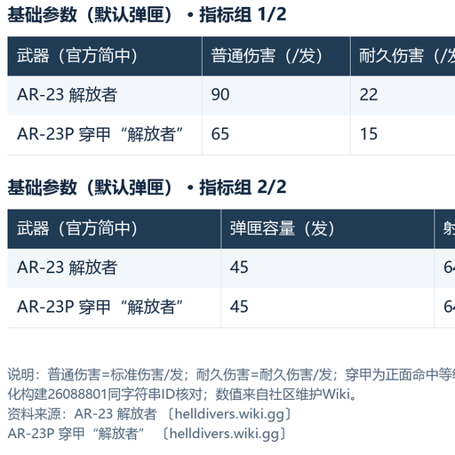
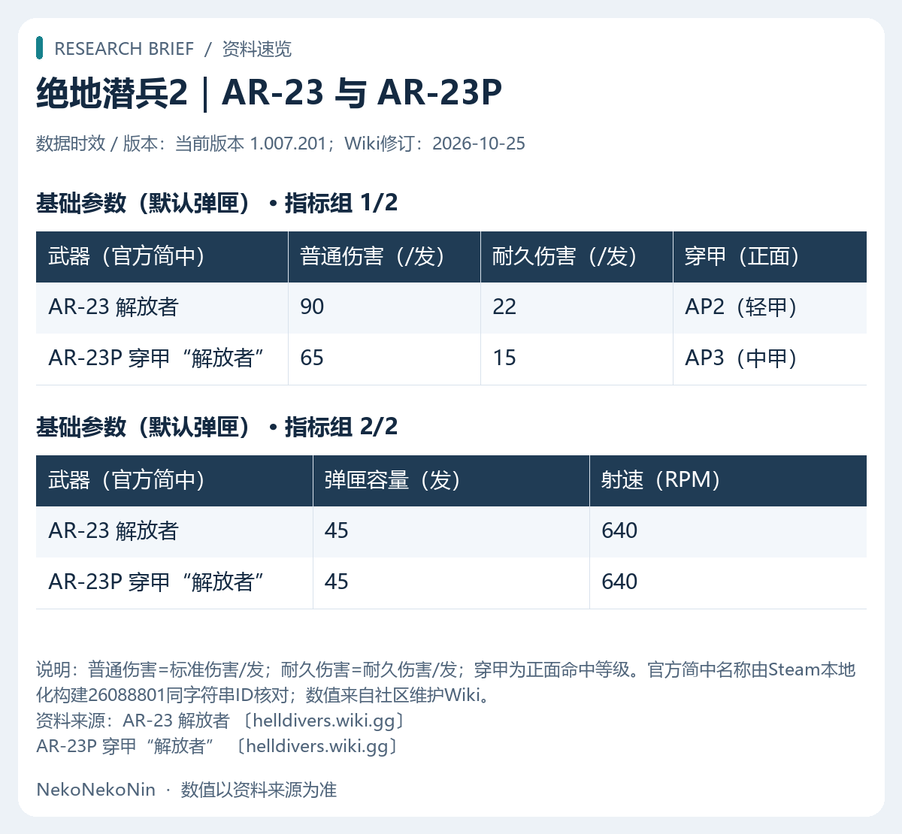

# NekoNekoNin · 资料卡与表格图

把查阅结果整理为参数卡或分组对比图，保留单位、版本和来源，支持纯文字偏好与失败回退。

版本：`1.1.1` · 许可：[MIT](LICENSE)

## 能做什么

- AI 查阅后选择参数卡、对比表或多组资料图，无需固定制图命令。
- 本地确定性排版生成 PNG，保留数值、单位、缺失值、版本和来源链接。
- 对漏掉工具调用的完整 Markdown 资料表进行兜底转换，失败保留文字。

## 安装

在 AstrBot 的插件管理上传本插件发布 ZIP，或使用[本仓库地址](https://github.com/NekoNekoNin/astrbot_plugin_research_cards)安装。内部插件名保持 `astrbot_plugin_research_cards`，升级时沿用已有配置。元数据已绑定本仓库，更新时请核对版本与更新记录。

依赖 Pillow 和中文字体，Windows 优先使用微软雅黑，Linux 可安装 Noto Sans CJK。无需浏览器截图服务或生图 API。需要允许本插件及其 research_table_image 工具。

## 设置

入口：**AstrBot → 插件 → NekoNekoNin · 资料卡与表格图 → 配置**。常用选项直接显示，适用时提供中文下拉标签、数值滑块、条件显示与高级折叠。完整选项见 [配置说明](docs/CONFIGURATION.md)。

## 聊天示例

- “查询一把武器的基础参数。”
- “比较几种方案的成本和适用条件。”
- “这次只要文字，不要发图。”

## 使用边界

本插件负责呈现，不替代资料来源与事实核实。默认最多 40 行、1–4 组、每组 2–8 列；宽表按指标分组。流式聊天可能先出现部分文字再补发图片。同一问题避免重复发图，用户要求纯文字时优先遵循。

## 预览



示例来自隔离功能验收，不是持续更新的游戏参数表。正式回答以当次查阅来源和版本为准。

## 开发与检查

```sh
python -m pip install -r requirements-dev.txt
python -m pytest -q
ruff check .
```

涉及实际 AstrBot 注册器的测试需提供框架源码路径 `ASTRBOT_SOURCE`；未提供时相关集成项明确跳过，不把跳过当作完整集成验收。联网与真实聊天验收另行执行。

封面使用相关原有图片素材，来源与权利说明见 [素材说明](docs/ASSETS.md)。

2026-10-26 已在 AstrBot 4.29.1 桌面版实际打开插件卡片和原生配置弹窗验收；普通设置无需独立网页。此验收不等同于重新测试全部聊天功能。
